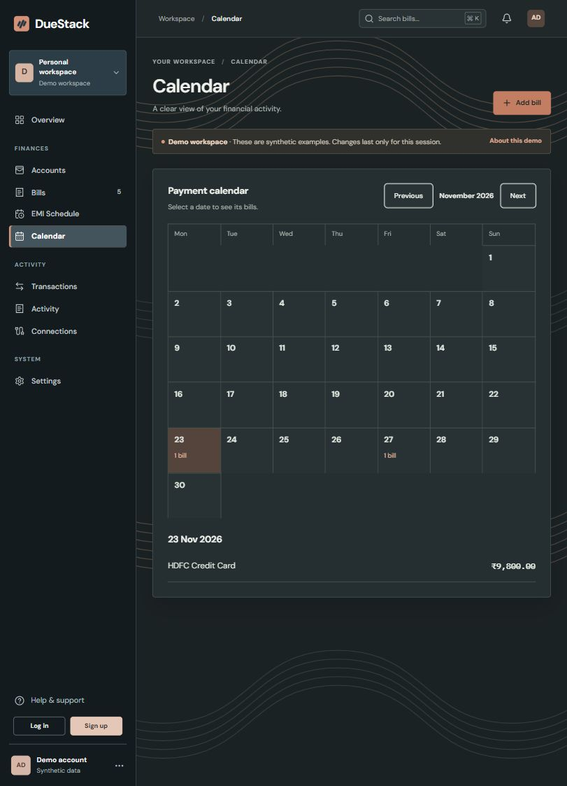
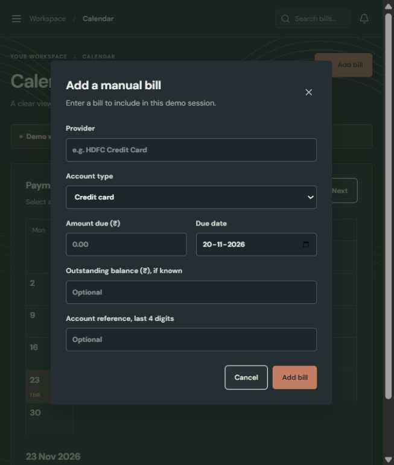
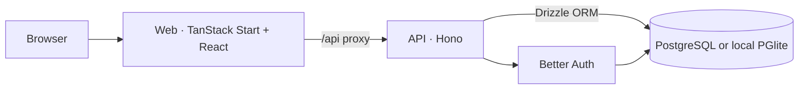

<h1 align="center">DueStack</h1>

<p align="center"><strong>A clearer view of what you owe.</strong></p>


DueStack is a development-stage dashboard for bringing credit obligations into one place. It is designed for people who track credit cards, buy-now-pay-later accounts, credit lines and loan instalments across different providers.

[About](#about) · [Screenshots](#screenshots) · [Features](#features) · [Architecture](#architecture) · [Quick start](#quick-start) · [Tests](#tests) · [Limitations](#limitations)

---

> **Development project:** Use synthetic data only. DueStack does not connect to lenders or move money.

## About

Keeping track of multiple payment dates can mean checking several apps and statements. DueStack provides a single view of manually entered bills, upcoming due dates and recorded balances, with a calendar and timeline to help users see what needs attention.

The project also explores the engineering behind a financial workspace: user-scoped records, exact amounts stored in paise, duplicate warnings, audit activity and idempotent payment simulations. Visitors can explore synthetic demo data; signed-in users can create their own records in the local development database.

DueStack is an early foundation. Bills are manually entered and unverified, and simulated payments do not settle real obligations. Automated discovery, lender integrations and production-ready financial workflows are planned, not currently available.

## Features

| | |
| --- | --- |
| **Overview** | See upcoming bills, recorded balances, the next due date and a payment timeline. |
| **Manual bills** | Add, search and delete bills; likely duplicates are flagged for review. |
| **Calendar** | Browse due dates by month and select a date to see its bills. |
| **Local accounts** | Sign up and log in with email and password; signed-in records are scoped to the user. |
| **Payment simulation** | Record an idempotent simulated attempt and view its history. No bill is settled. |

## Project status

| Area | Status |
| --- | --- |
| Dashboard, manual bills and local authentication | Available for development use |
| Payment flow | Simulation only; no real payment integration |
| Lender connections and statement import | Not implemented |
| Email verification, password reset and reminders | Not implemented |
| Production deployment and security hardening | Not complete |

## Screenshots

Captured locally with synthetic demo data.

| Overview | Payment calendar |
| :---: | :---: |
|  |  |

| Add a bill | Login |
| :---: | :---: |
|  |  |

## Architecture



| Component | Role |
| --- | --- |
| `apps/web` | React interface, routes and responsive styles |
| `apps/api` | Hono endpoints, validation and authentication |
| `packages/db` | Drizzle schema and migrations |
| `packages/shared` | Shared financial types and calculations |
| `tests` | Financial-rule and API tests |

Amounts are stored as integer paise. Anonymous demo data is synthetic and lasts for the current session; signed-in manual records are stored in the development database.

## Quick start

Requires **Node.js 22.12+** and npm.

```bash
npm install
npm run dev
```

Open [http://127.0.0.1:5173](http://127.0.0.1:5173). The web app and API start together. Without `DATABASE_URL`, a persistent local PGlite database is created in `.data/postgres` and migrations are applied at startup.

To use PostgreSQL, set the environment variables described in [`.env.example`](.env.example). The included Compose file starts a local PostgreSQL database.

## Stack

- **Web:** TypeScript · React · TanStack Start · Tailwind CSS
- **API:** Node.js · Hono · Better Auth · Zod
- **Data:** Drizzle ORM · PostgreSQL · PGlite
- **Build and testing:** Vite · Vitest

## Tests

```bash
npm test
npm run typecheck
npm run build
```

The tests cover financial rules, API validation, user isolation, duplicate detection and payment-simulation idempotency.

## Limitations

- No real or sandbox lender, Gmail, Bharat Connect or payment-partner integration is connected.
- Statement extraction, full EMI schedules, background reminders and reconciliation are not implemented.
- Email verification, password reset, data export/deletion and production security work are still needed.
- Simulation records do not move money or mark a real bill as paid.
