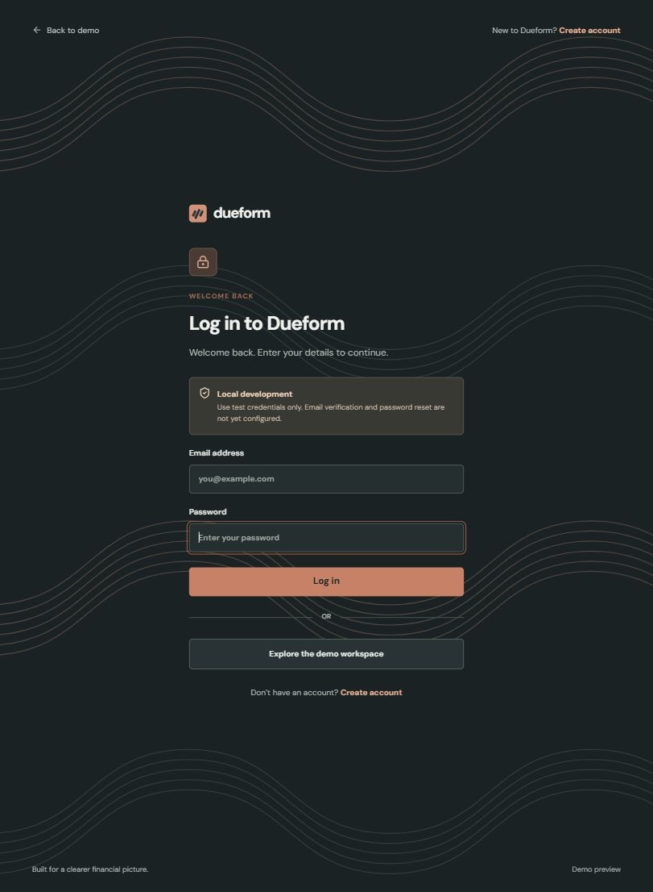
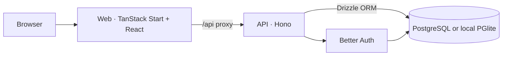

# Dueform

**A clearer view of what you owe.**

Bring manually recorded credit bills and due dates into one place, see what is coming up, and explore repayment simulations in a focused dashboard.

[Screenshots](#screenshots) · [Features](#features) · [Architecture](#architecture) · [Quick start](#quick-start) · [Tests](#tests) · [Limitations](#limitations)

---

> **Development project:** Use synthetic data only. Dueform does not connect to lenders or move money.

## Features

| | |
| --- | --- |
| **Overview** | See upcoming bills, recorded balances, the next due date and a payment timeline. |
| **Manual bills** | Add, search and delete bills; likely duplicates are flagged for review. |
| **Calendar** | Browse due dates by month and select a date to see its bills. |
| **Local accounts** | Sign up and log in with email and password; signed-in records are scoped to the user. |
| **Payment simulation** | Record an idempotent simulated attempt and view its history. No bill is settled. |

## Project status

| Area | Status |
| --- | --- |
| Dashboard, manual bills and local authentication | Available for development use |
| Payment flow | Simulation only; no real payment integration |
| Lender connections and statement import | Not implemented |
| Email verification, password reset and reminders | Not implemented |
| Production deployment and security hardening | Not complete |

## Screenshots

Captured locally with synthetic demo data.

| Overview | Payment calendar |
| :---: | :---: |
|  |  |

| Add a bill | Login |
| :---: | :---: |
|  |  |

## Architecture



| Component | Role |
| --- | --- |
| `apps/web` | React interface, routes and responsive styles |
| `apps/api` | Hono endpoints, validation and authentication |
| `packages/db` | Drizzle schema and migrations |
| `packages/shared` | Shared financial types and calculations |
| `tests` | Financial-rule and API tests |

Amounts are stored as integer paise. Anonymous demo data is synthetic and lasts for the current session; signed-in manual records are stored in the development database.

## Quick start

Requires **Node.js 22.12+** and npm.

```bash
npm install
npm run dev
```

Open [http://127.0.0.1:5173](http://127.0.0.1:5173). The web app and API start together. Without `DATABASE_URL`, a persistent local PGlite database is created in `.data/postgres` and migrations are applied at startup.

To use PostgreSQL, set the environment variables described in [`.env.example`](.env.example). The included Compose file starts a local PostgreSQL database.

## Stack

- **Web:** TypeScript · React · TanStack Start · Tailwind CSS
- **API:** Hono · Better Auth · Zod
- **Data:** Drizzle ORM · PostgreSQL · PGlite
- **Testing:** Vitest

## Tests

```bash
npm test
npm run typecheck
npm run build
```

The tests cover financial rules, API validation, user isolation, duplicate detection and payment-simulation idempotency.

## Limitations

- No real or sandbox lender, Gmail, Bharat Connect or payment-partner integration is connected.
- Statement extraction, full EMI schedules, background reminders and reconciliation are not implemented.
- Email verification, password reset, data export/deletion and production security work are still needed.
- Simulation records do not move money or mark a real bill as paid.
