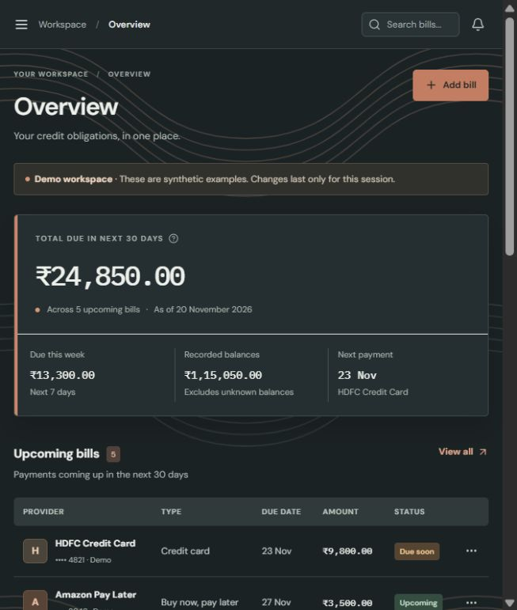

<div align="center">

# dueform

**A clearer view of what you owe.**

A unified workspace for tracking credit bills, due dates and repayments.

`TypeScript` · `React` · `TanStack Start` · `Hono` · `Tailwind CSS`

`Drizzle ORM` · `PostgreSQL / PGlite` · `Better Auth` · `Zod` · `Vitest`

</div>

---

### At a glance

- Track manual bills and upcoming dues in one dashboard.
- Explore due dates in the calendar and review account activity.
- Try payment simulations without moving money.

### Screenshots

*Shown with synthetic demo data.*

| Overview | Payment calendar |
| :---: | :---: |
|  |  |

| Add a bill | Login |
| :---: | :---: |
|  |  |

### Get started

Requires **Node.js 22.12+**.

```bash
npm install
npm run dev
```

Open [localhost:5173](http://127.0.0.1:5173). A local PGlite database is created automatically. To use PostgreSQL instead, configure the environment variables shown in [`.env.example`](.env.example).

```bash
npm test            # Run tests
npm run typecheck   # Check TypeScript
npm run build       # Build the web app
```

### Current status

Dueform is a **development-stage project**. Use synthetic data only. Manual records and local authentication work; statement import, email verification, password reset, reminders and live lender connections are still in development. Payment simulations do not settle bills or move money.

